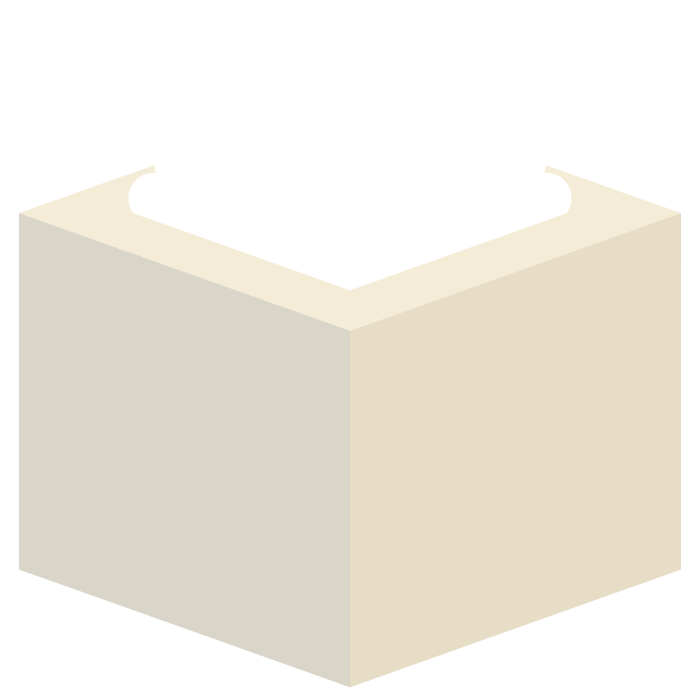

    
    <h1>Koji logo</h1>
    
A masu (枡), the wooden box used to measure rice, filled with koji (麹), the rice that turns into sake, miso and soy sauce.

## License

The Koji logo is licensed under the [Creative Commons Attribution 4.0 International License (CC BY 4.0)](https://creativecommons.org/licenses/by/4.0/).

You are free to share and adapt it, for any purpose, as long as you give credit:

> Koji logo by Felipe Coletti, licensed under CC BY 4.0.

This license does not imply any endorsement by the Koji project.